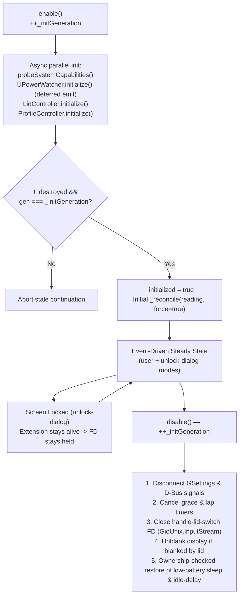
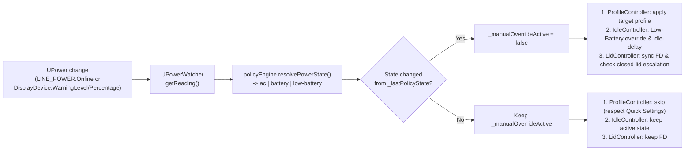
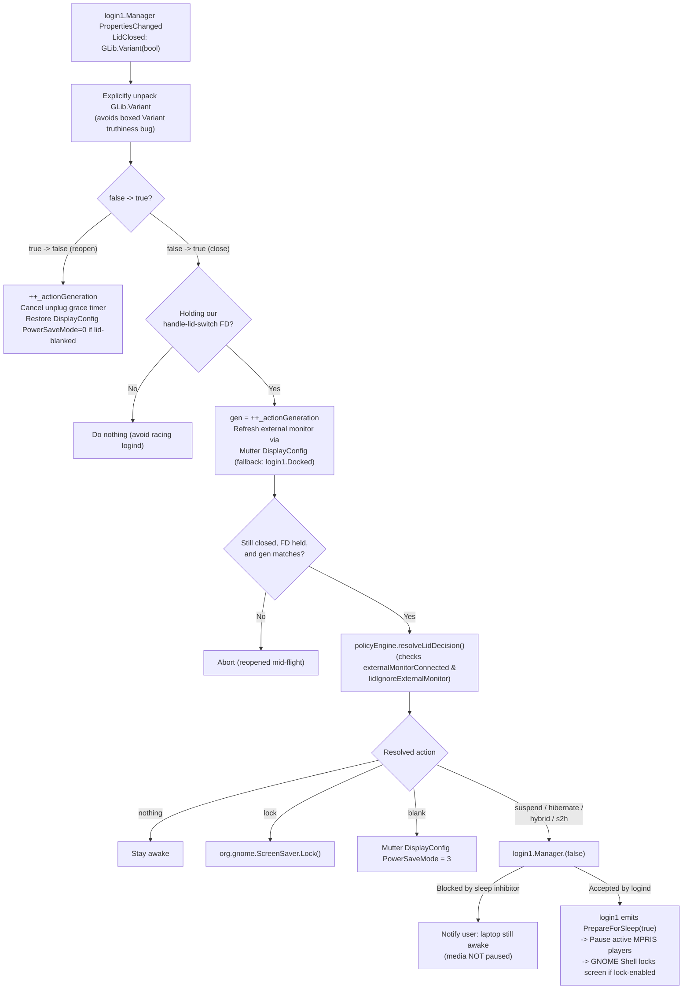

# Architecture, Runtime Lifecycle, and Upstream GNOME Gap Analysis

This document explains **what is alive at runtime**, **which system services and checks are involved**, **how internal state and event flows work**, and **which parts of this extension are workarounds ("hoops") that an upstream GNOME Settings / `gnome-settings-daemon` implementation should replace with cleaner native primitives**.

---

## 1. What Processes Are Alive (and When)

Power States spawns **zero background daemons**, **zero root helpers**, and **zero long-running subprocesses**.

| Runtime Component | Host Process | Runs As | When Alive | What It Owns |
|---|---|---|---|---|
| **Extension runtime** (`extension.js` + `lib/*.js`) | `gnome-shell` | Desktop user | While enabled in `user` and `unlock-dialog` session modes | D-Bus proxies, pure policy evaluation, `handle-lid-switch` FD, GSettings watchers |
| **Preferences UI** (`prefs.js`) | `gjs` (`gnome-extensions prefs` / Extensions app) | Desktop user | Only while the Preferences window is open | Libadwaita UI, live capability probe, direct edits to extension & native GNOME GSettings |
| **System / Session Daemons (existing OS services)** | `upowerd`, `tuned-ppd` / `power-profiles-daemon`, `systemd-logind`, `gsd-power`, `mutter` (`gnome-shell`), `org.gnome.ScreenSaver` | System / user | Managed by OS | Actual hardware readings, CPU/platform profile application, sleep/hibernate execution, idle timers, display power & locking |

### External Daemons & Exact System Checks

| Daemon / Bus | Interface & Path | Checks / Signals Used | Privilege / Polkit Model |
|---|---|---|---|
| **UPower** (System bus) | `org.freedesktop.UPower` (`/org/freedesktop/UPower`), `org.freedesktop.UPower.Device` (`DisplayDevice` + every `Type=1` `LINE_POWER` device) | `EnumerateDevices()`, `DeviceAdded`, `DeviceRemoved`, `Online`, `OnBattery`, `State`, `WarningLevel`, `Percentage`, `LidIsPresent`, **`LidIsClosed`** (dual-source fallback for systemd ≤ 255) | Read-only; no authentication |
| **Power Profiles** (System bus) | `org.freedesktop.UPower.PowerProfiles` (fallback: `net.hadess.PowerProfiles`) | Reads `Profiles`, `ActiveProfile`, `ActiveProfileHolds`, `PerformanceDegraded`; writes `ActiveProfile`; watches `g-name-owner` for late startup | Active local user allowed by PPD / `tuned-ppd` Polkit policy |
| **systemd-logind** (System bus) | `org.freedesktop.login1.Manager` (`/org/freedesktop/login1`), `org.freedesktop.login1.Session` (`/org/freedesktop/login1/session/auto`) | `CanSuspend()`, `CanHibernate()`, `CanHybridSleep()`, `CanSuspendThenHibernate()`, `Inhibit("handle-lid-switch", ..., "block")`, bounded `Inhibit("sleep", ..., "delay")` (when MPRIS pause is enabled), `Suspend(false)` / `Hibernate(false)` / `HybridSleep(false)` / `SuspendThenHibernate(false)`, `LidClosed`, `Docked`, `PrepareForSleep`, `Session.Active` (fast user switching) | Polkit `inhibit-handle-lid-switch`, `inhibit-delay-sleep`, `suspend`, `hibernate` default to `implicit active: yes` on standard desktop distros |
| **Mutter DisplayConfig** (Session bus) | `org.gnome.Mutter.DisplayConfig` (`/org/gnome/Mutter/DisplayConfig`) | `GetCurrentState()` (checks `is-builtin` monitor property), `MonitorsChanged`, writable `PowerSaveMode` (`0`=On, `3`=Off) | Same user session |
| **GNOME ScreenSaver** (Session bus) | `org.gnome.ScreenSaver` (`/org/gnome/ScreenSaver`) | `Lock()` when lid action is `lock` | Same user session |
| **MPRIS Media Players** (Session bus) | `org.mpris.MediaPlayer2.*` (`/org/mpris/MediaPlayer2`) | `Pause()` fired on `PrepareForSleep(true)` (only when sleep is actually accepted by `logind`) | Same user session |
| **GNOME Settings Daemon** (GSettings) | `org.gnome.settings-daemon.plugins.power`, `org.gnome.desktop.session` | Direct source-of-truth for `sleep-inactive-{ac,battery}-{type,timeout}`; managed per-state swap for `idle-delay` | User `dconf` database |

---

## 2. Lifecycle: Enable, Lock Screen, and Disable

### Why `session-modes` Includes `"unlock-dialog"`
GNOME Shell calls `disable()` on user-only extensions whenever the screen locks. If `disable()` ran on lock, closing the `handle-lid-switch` FD while the laptop lid is closed (or about to be closed on AC) would cause `systemd-logind` to re-evaluate the closed lid and suspend immediately. Keeping the extension loaded in `["user", "unlock-dialog"]` preserves the FD across lock/unlock with zero UI or input hooks exposed on the lock screen.

---

## 3. Event Flows: What Leads to What

### A. Physical Power State Transition & Manual Override Flow

- **Transition defaults, not hard locks:** If the user switches Power Mode in GNOME Quick Settings, `ProfileController` sees an `ActiveProfile` change that does not match `_pendingRequestedProfile`, sets `_manualOverrideActive = true`, and stops writing profiles until the next physical power transition (or an explicit edit to the *active* state's Power Mode in Preferences).
- **Key-routed preference edits:** Changing unrelated preferences (notifications, lid policy, idle timeouts, or an *inactive* state's profile) never clears `_manualOverrideActive`.

### B. Lid-Close & External Monitor Flow

### C. Unplug-While-Closed Grace Flow
If AC is disconnected while `LidClosed === true` (`ac → battery` or `battery → low-battery`) and the new state's lid action is active (`suspend`, `hibernate`, `lock`, `blank`):
1. `LidController.scheduleGraceAction(graceSeconds, ...)` starts a one-shot `GLib.timeout_add_seconds` timer tied to a new `_actionGeneration`.
2. Reopening the lid, reconnecting AC, or changing policy increments `_actionGeneration` and cancels the timer cleanly.
3. When the timer expires, external-monitor status and lid state are re-verified right before invoking the action.

---

## 4. Internal State Map

### Persistent Configuration (`dconf` / GSettings)
- **Extension schema** (`org.gnome.shell.extensions.power-states`):
  - Per-state (`ac`, `battery`, `low-battery`): `*-power-profile`, `*-lid-action`, `*-lid-ignore-external-monitor`, `*-idle-action`, `*-idle-timeout`, `*-screen-blank`.
  - Global: `sleep-mode`, `low-battery-mode`, `low-battery-percentage`, `unplug-while-closed-mode`, `unplug-while-closed-grace-seconds`, `pause-media-on-suspend`, `notifications`.
  - Hidden crash-recovery journal (`recovery-idle-delay-*`, `recovery-low-bat-*`): persists pre-override baselines and last-applied values so unclean Shell exits restore cleanly on next startup without clobbering intervening external GNOME Settings edits.
- **Native GNOME schemas (direct source of truth where native keys exist):**
  - `org.gnome.settings-daemon.plugins.power`: `sleep-inactive-ac-{type,timeout}`, `sleep-inactive-battery-{type,timeout}`.
  - `org.gnome.desktop.session`: `idle-delay` (managed on transition with ownership check & external-edit relinquishment).

### Ephemeral In-Memory State (Lives Only While Enabled)

| Controller | State Field(s) | Purpose | Cleared / Restored On |
|---|---|---|---|
| `PowerStatesExtension` | `_initGeneration`, `_initialized`, `_destroyed` | Prevents rapid `disable()` → `enable()` races from stale async continuations | Every `enable()` / `disable()` |
| `PowerStatesExtension` | `_lastPolicyState`, `_manualOverrideActive` | Transition-only tracking & preserving manual Quick Settings overrides | Physical state change / active profile edit / `disable()` |
| `UPowerWatcher` | `_ready`, `_linePowerDevices` Map | Suppresses premature events during initial enumeration; watches all `LINE_POWER` adapters | `destroy()` |
| `ProfileController` | `_pendingRequestedProfile`, `_lapDebounceId` | Distinguishes our profile writes from external Quick Settings clicks; retries after `lap-detected` | Property ack / timeout / `destroy()` |
| `LidController` | `_inhibitorStream` (OS FD), `_wantInhibitor`, `_inhibitInFlight`, `_lidClosed`, `_externalMonitorConnected`, `_actionGeneration`, `_graceTimerId`, `_blankedByLid` | Safe unprivileged FD ownership, race-free async cancellation, and clamshell awareness | Lid reopen / policy change / `destroy()` |
| `IdleController` | `_baselineIdleDelay`, `_lastAppliedIdleDelay`, `_baselineBatterySleep*`, `_lastAppliedLow*`, `_lowBatteryOverrideActive` | Ownership-checked restoration so external GNOME Settings edits are never overwritten | Leaving Low Battery / `Leave Unchanged` / `disable()` |

---

## 5. Extension Workarounds ("Hoops") vs. Native Upstream GNOME Design

Because a GNOME Shell extension cannot modify `gnome-control-center`, `gnome-settings-daemon` (`gsd-power`), or `gsettings-desktop-schemas`, Power States intentionally bridges several gaps. If this feature is brought upstream to GNOME, **these workarounds should be eliminated in favor of native primitives**:

| Area | Extension Workaround ("Hoop") | Clean Upstream GNOME Implementation |
|---|---|---|
| **Screen Blank (`idle-delay`)** | GNOME only has one global `org.gnome.desktop.session.idle-delay`. The extension swaps it on state change, requires a `"Leave Unchanged"` option, and tracks ownership to restore on `disable()`. | Split into per-source keys (e.g., `idle-delay-ac` and `idle-delay-battery`, or state-scoped keys in `gsettings-desktop-schemas` / `gsd-power`). Eliminates `"Leave Unchanged"` and swap/restore logic completely. |
| **Low-Battery Auto-Suspend** | Extension temporarily overwrites `sleep-inactive-battery-{type,timeout}` while in Low Battery and restores the snapshot on exit (with ownership checks). | Handle Low Battery inactivity delay natively inside `gsd-power` without mutating the user's normal Battery GSettings keys. |
| **Lid-Close Action** | Extension takes a second `handle-lid-switch` FD inhibitor inside `gnome-shell` (requiring `unlock-dialog` session mode) and calls `login1.Manager.Suspend(false)` itself; cannot govern pre-login GDM or logged-out states. | `gsd-power` (`gsd-power-manager.c`) **already** owns GNOME's external-monitor `handle-lid-switch` inhibitor and 8s display-reconfig grace timer (`LID_CLOSE_SAFETY_TIMEOUT`). Extending `gsd-power` (or coordinating with `systemd-logind`) removes the second inhibitor and handles VT switches, lock screen, and multi-session boundaries cleanly. |
| **Power Mode Automation** | Extension writes `ActiveProfile` directly on PPD / `tuned-ppd`, which acts like a user selection and can cancel existing application/GSD holds (such as `gsd-power`'s own `power-saver-profile-on-low-battery` hold). | Implement inside `gsd-power` (`gnome-settings-daemon#715`), coordinating cleanly with `HoldProfile`, `gsd-power`'s low-battery hold, and `tuned-ppd`/`PPD`'s `BatteryAware` flag — defaulting to `"Leave Unchanged"` so upstream GNOME's default behavior stays untouched unless opted in. |
| **Low Battery Threshold** | Custom `%` runs inside the extension only and can diverge from `/etc/UPower/UPower.conf` and GNOME's built-in low-battery notifications. | Either keep a single system threshold from UPower (no custom % knob in GNOME Settings) or expose threshold adjustment through UPower so alerts and power policies never disagree. |
| **Unplug-While-Closed Delay** | Extension maintains a custom 3s `GLib.timeout_add_seconds` grace timer. | Fold cleanly into `gsd-power`'s existing lid safety-timer logic with no user-facing knob needed in Settings. |
| **Technical `ⓘ` Info Popovers** | Included in the extension so power users understand how an external extension interacts with `logind`, `UPower`, and GNOME Settings. | **Remove** in upstream GNOME Settings — native Settings panels should be self-explanatory without explaining daemon plumbing. |

---

## 6. Readiness for Upstream GNOME / GitLab Contribution

### What Is Ready Now (Design Proposal)
The **UI model and interaction philosophy** are in strong shape for a **GNOME Design proposal** (`Teams/Design/settings-mockups`) and discussion on `gnome-settings-daemon#715` and `gnome-control-center#1223`:
- **Scoped `Adw.ToggleGroup` (`Plugged In | On Battery | Low Battery`)** keeps global settings global (solving KDE PowerDevil's 3× repetition of hardware controls) while making per-state behavior scannable in one Libadwaita page.
- **Plain-language GNOME HIG copy**, **single-row Automatic Suspend** (with disabled Delay when Off), **positive clamshell phrasing** (*"Even With External Monitor Connected"*), and **opt-in `"Leave Unchanged"`** defaults fit GNOME's design culture well.
- **"Transition defaults, not hard locks"** directly answers Bastien Nocera's objection in `gnome-control-center#1600` (that users plugged into AC may still want quiet operation or manual overrides without the system fighting them).

### What Should Happen Before Filing Upstream Code MRs
1. **Dogfood this v1 extension on real hardware first** (actual lid close/open cycles, suspend/resume, dock hotplug, unplug-while-closed, low-battery transitions, and lock-screen behavior across a week or two of daily use) so every real-world edge case is proven, not theoretical.
2. **Start upstream with Design + `gsd-power`, not a `gnome-control-center` MR:**
   - Upstream maintainers explicitly stated (`gnome-control-center#1600`) that **`gnome-settings-daemon#715`** must be settled before Settings UI merges.
   - Lid-close (`gnome-control-center#1223` / `gsd#712`) needs agreement from GNOME Design + `gsd-power` maintainers on ownership (`gsd-power` vs `systemd-logind`) and the external-monitor edge cases.
3. **Strip extension-only knobs from the upstream mockup:** For an upstream GNOME Settings pitch, omit the technical `ⓘ` popovers, `Unplug Delay When Closed`, `Transition Notifications`, `Custom` Low Battery %, and `Leave Unchanged` on Screen Blank (assuming native per-state `idle-delay` keys) — keeping the upstream pitch razor-thin and unmistakably GNOME.
