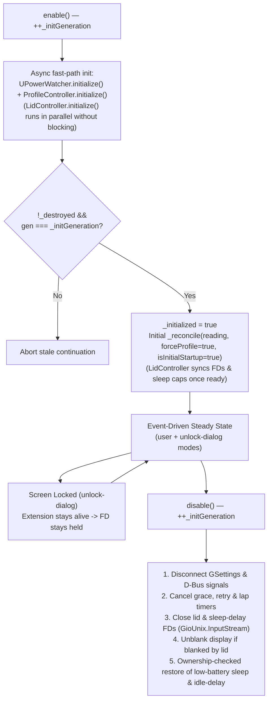
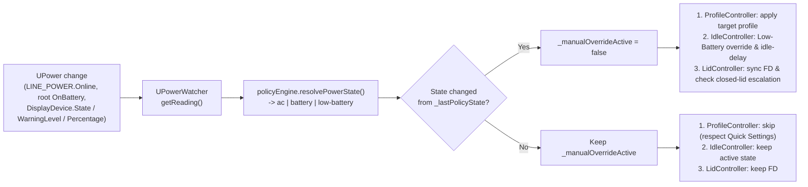
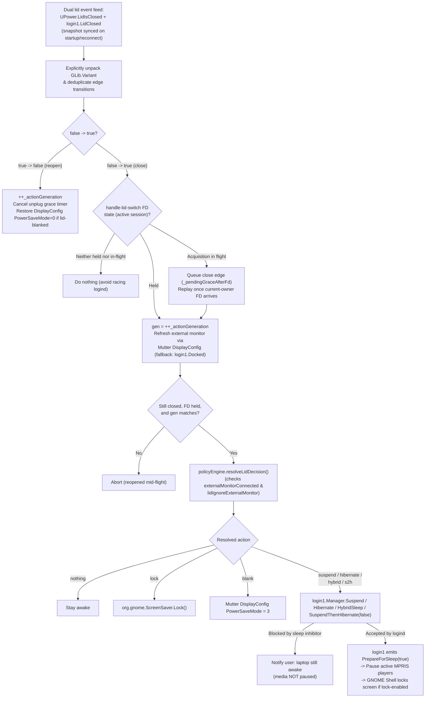

# Architecture, Runtime Lifecycle, and Upstream GNOME Gap Analysis

This document explains **what is alive at runtime**, **which system services and checks are involved**, **how internal state and event flows work**, and **which parts of this extension are workarounds ("hoops") that an upstream GNOME Settings / `gnome-settings-daemon` implementation should replace with cleaner native primitives**.

---

## 1. What Processes Are Alive (and When)

Power States spawns **zero background daemons**, **zero root helpers**, and **zero long-running subprocesses**.

| Runtime Component | Host Process | Runs As | When Alive | What It Owns |
|---|---|---|---|---|
| **Extension runtime** (`extension.js` + `lib/*.js`) | `gnome-shell` | Desktop user | While enabled in `user` and `unlock-dialog` session modes | D-Bus proxies, pure policy evaluation, `handle-lid-switch` FD, GSettings watchers |
| **Preferences UI** (`prefs.js`) | `gjs` (`gnome-extensions prefs` / Extensions app) | Desktop user | Only while the Preferences window is open | Libadwaita UI, live capability probe, direct edits to extension & native GNOME GSettings |
| **System / Session Daemons (existing OS services)** | `upowerd`, `tuned-ppd` / `power-profiles-daemon`, `systemd-logind`, `gsd-power`, `mutter` (`gnome-shell`), `org.gnome.ScreenSaver` | System / user | Managed by OS | Actual hardware readings, CPU/platform profile application, sleep/hibernate execution, idle timers, display power & locking |

### External Daemons & Exact System Checks

| Daemon / Bus | Interface & Path | Checks / Signals Used | Privilege / Polkit Model |
|---|---|---|---|
| **UPower** (System bus) | `org.freedesktop.UPower` (`/org/freedesktop/UPower`), `org.freedesktop.UPower.Device` (`DisplayDevice` + every `Type=1` `LINE_POWER` device) | `EnumerateDevices()`, `DeviceAdded`, `DeviceRemoved`, `Online`, `OnBattery`, `State`, `WarningLevel`, `Percentage`, `LidIsPresent`, **`LidIsClosed`** (required for lid inhibition so systemd ≤ 255 works reliably; dropping off the bus releases the lid FD immediately) | Read-only; no authentication |
| **Power Profiles** (System bus) | `org.freedesktop.UPower.PowerProfiles` and legacy `net.hadess.PowerProfiles` | Reads `Profiles`, `ActiveProfile`, `ActiveProfileHolds`, `PerformanceDegraded`; async `Properties.Set` for `ActiveProfile`; watches `g-name-owner` on **both** bus names | Active local user allowed by PPD / `tuned-ppd` Polkit policy |
| **systemd-logind** (System bus) | `org.freedesktop.login1.Manager` (`/org/freedesktop/login1`), canonical `org.freedesktop.login1.Session` resolved via `XDG_SESSION_ID` / `GetSessionByPID(0)` / `User.Display` | `GetSession()`, `GetSessionByPID(0)`, `User.Display`, `CanSuspend()`, `CanHibernate()`, `CanHybridSleep()`, `CanSuspendThenHibernate()`, `Inhibit("handle-lid-switch", ..., "block")`, bounded `Inhibit("sleep", ..., "delay")` with `_preparingForSleep` state machine, `Suspend(false)` / `Hibernate(false)` / `HybridSleep(false)` / `SuspendThenHibernate(false)`, `LidClosed`, `Docked`, `PrepareForSleep`, `Session.Active`, and `g-name-owner` restart recovery | Polkit `inhibit-handle-lid-switch`, `inhibit-delay-sleep`, `suspend`, `hibernate` default to `implicit active: yes` on standard desktop distros |
| **Mutter DisplayConfig** (Session bus) | `org.gnome.Mutter.DisplayConfig` (`/org/gnome/Mutter/DisplayConfig`) | `GetCurrentState()` (filters by active `logical_monitors`, checks `is-builtin` with sole-panel fallback), `MonitorsChanged`, writable `PowerSaveMode` (`0`=On, `3`=Off) | Same user session |
| **GNOME ScreenSaver** (Session bus) | `org.gnome.ScreenSaver` (`/org/gnome/ScreenSaver`) | `Lock()` when lid action is `lock` | Same user session |
| **MPRIS Media Players** (Session bus) | `org.mpris.MediaPlayer2.*` (`/org/mpris/MediaPlayer2`) | `Pause()` fired on `PrepareForSleep(true)` (only when sleep is actually accepted by `logind`) | Same user session |
| **GNOME Settings Daemon** (GSettings) | `org.gnome.settings-daemon.plugins.power`, `org.gnome.desktop.session` | Direct source-of-truth for `sleep-inactive-{ac,battery}-{type,timeout}`; managed per-state swap for `idle-delay` | User `dconf` database |

---

## 2. Lifecycle: Enable, Lock Screen, and Disable

### Why `session-modes` Includes `"unlock-dialog"`
GNOME Shell calls `disable()` on user-only extensions whenever the screen locks. If `disable()` ran on lock, closing the `handle-lid-switch` FD while the laptop lid is closed (or about to be closed on AC) would cause `systemd-logind` to re-evaluate the closed lid and suspend immediately. Keeping the extension loaded in `["user", "unlock-dialog"]` preserves the FD across lock/unlock with zero UI or input hooks exposed on the lock screen.

---

## 3. Event Flows: What Leads to What

### A. Physical Power State Transition & Manual Override Flow

- **Stale USB-C adapter reconciliation:** `UPowerWatcher` treats unanimous `LINE_POWER.Online=true` + `OnBattery=false` (or a fresh `false → true` plug-in edge within a 2s window) as immediate AC. If an adapter stays stale `Online=true` without a fresh plug-in edge while `UPower.OnBattery=true`, `DisplayDevice.State` breaks the tie (`Discharging`/`PendingDischarge` → Battery; unknown/missing `DisplayDevice` → deferred as incomplete `known=false` while retrying `DisplayDevice` attachment).
- **Transition defaults, not hard locks:** If the user switches Power Mode in GNOME Quick Settings, `ProfileController` sees an `ActiveProfile` change not matched by `_expectedEchoes` (independent of `PerformanceDegraded` signal batching), clears `_lastCommittedTarget`, sets `_manualOverrideActive = true`, and stops writing profiles until the next physical power transition (or an explicit edit to the *active* state's Power Mode in Preferences).
- **Key-routed preference edits:** Changing unrelated preferences (notifications, lid policy, idle timeouts, or an *inactive* state's profile) never clears `_manualOverrideActive`.

### B. Lid-Close & External Monitor Flow

### C. Unplug-While-Closed Grace Flow
When a closed laptop (`LidClosed === true`) loses AC power (`ac → battery` or `ac → low-battery`) or crosses down into Low Battery (`battery → low-battery`) and the new state's lid action is active (`suspend`, `hibernate`, `lock`, `blank`):
1. If an external monitor is currently blocking the lid action (`blockedByExternalMonitor === true` when power drops on a USB-C dock), `PowerStatesExtension` sets `_undockDeadlineUs` (a 15-second monotonic correlation window) instead of scheduling the timer yet; an external-monitor disconnect within that window (in either disconnect-first or battery-shift-first order) schedules the grace action via `_tryConsumeDeferredUndock()`, while a display-only disconnect on AC or after the window expires never triggers suspend.
2. Otherwise, `LidController.scheduleGraceAction(graceSeconds, ...)` starts a one-shot `GLib.timeout_add_seconds` timer tied to a new `_actionGeneration`. Bouncing between `battery` and `low-battery` while still on battery with an active lid action preserves the original deadline instead of cancelling or restarting it.
3. Reopening the lid, reconnecting AC, redocking an external monitor, or changing policy clears `_undockDeadlineUs`, increments `_actionGeneration`, and cancels the timer cleanly.
4. When the timer expires, external-monitor status and lid state are re-verified right before invoking the action.

---

## 4. Internal State Map

### Persistent Configuration (`dconf` / GSettings)
- **Extension schema** (`org.gnome.shell.extensions.power-states`):
  - Per-state (`ac`, `battery`, `low-battery`): `*-power-profile`, `*-lid-action`, `*-lid-ignore-external-monitor`, `*-idle-action`, `*-idle-timeout`, `*-screen-blank`.
  - Global: `sleep-mode`, `low-battery-mode`, `low-battery-percentage`, `unplug-while-closed-mode`, `unplug-while-closed-grace-seconds`, `pause-media-on-suspend`, `notifications`.
  - Single atomic JSON recovery journal (`recovery-state`, strictly single-writer owned by `IdleController` in `extension.js`, read-only from `prefs.js`): records per-key `{ baseline, applied, pending }` entries and external-edit relinquishment markers bound to the configured value at relinquishment (or on first complete startup after crash recovery), so offline Preferences edits are detected automatically on next enable without `prefs.js` writing to `recovery-state`. If running against a stale cached Wayland schema missing `recovery-state`, temporary native overrides are deferred until the next login reloads the schema.
- **Native GNOME schemas (direct source of truth where native keys exist):**
  - `org.gnome.settings-daemon.plugins.power`: `sleep-inactive-ac-{type,timeout}`, `sleep-inactive-battery-{type,timeout}`.
  - `org.gnome.desktop.session`: `idle-delay` (managed on transition with per-key WAL & external-edit relinquishment).

### Ephemeral In-Memory State (Lives Only While Enabled)

| Controller | State Field(s) | Purpose | Cleared / Restored On |
|---|---|---|---|
| `PowerStatesExtension` | `_initGeneration`, `_initialized`, `_destroyed`, `_initialReconcilePending`, `_loginCapProbeGeneration`, `_loginCapRetryTimerId` | Prevents stale async continuations, defers startup policy until complete UPower readings arrive, and refreshes `logind` sleep capabilities per owner generation with bounded retry | Every `enable()` / `disable()` / `logind` owner change |
| `PowerStatesExtension` | `_lastPolicyState`, `_lastLidPolicyState`, `_manualOverrideActive`, `_undockDeadlineUs` | Transition-only tracking (keeping lid escalation state independent of pre-lid-ready profile updates), manual Quick Settings preservation, and 15s-bounded USB-C undock replay (never triggering on display-only AC disconnects) | Physical state change / lid reopen / active profile edit / `disable()` |
| `UPowerWatcher` | `_ready`, `_ownerGen`, `_linePowerDevices` Map, `_attachingLinePower` Map (token-keyed), `_attachingDisplay`, `_freshAcEdgeUntilUs` | Suppresses premature events during initial enumeration; invalidates in-flight `LINE_POWER` attachments on `DeviceRemoved`; distinguishes fresh plug-in edges from stale USB-C adapters | `notify::g-name-owner` / `DeviceRemoved` / `destroy()` |
| `ProfileController` | `_candidates`, `_activeEntry`, `_inFlightWrite`, `_queuedWrite`, `_lastCommittedTarget`, `_expectedEchoes`, `_echoExpireTimerId`, `_lapDebounceId` | Serialized PPD writes across modern & legacy buses (with bounded no-op echo expiry); distinguishes extension echoes from manual Quick Settings edits independently of `PerformanceDegraded` batching | Echo/reply completion / expiry / `destroy()` |
| `LidController` | `_inhibitorStream`, `_sleepDelayStream`, `_loginOwnerGen`, `_lidInFlightOwnerGen`, `_sleepDelayInFlightOwnerGen`, `_sessionActive`, `_lidClosed`, `_externalMonitorConnected`, `_monitorQueryInFlight`, `_monitorRefreshQueued`, `_monitorNotifyPending`, `_preparingForSleep`, `_actionGeneration`, `_graceTimerId`, `_graceMonitorCheckInFlight`, `_pendingGraceAfterFd` | Fail-closed canonical session gating, owner-generation FD lifecycle, single-flight coalesced topology queries (filtering by active `logical_monitors`), startup/reconnect lid snapshots, and queued close/grace replay | Lid reopen / policy change / owner change / `destroy()` |
| `IdleController` | Single atomic `recovery-state` JSON key (sole writer) | Per-key ownership, crash recovery, and external-edit relinquishment surviving same-state disable/enable while detecting offline Preferences changes | Physical state transition / explicit prefs edit / `destroy()` |

---

## 5. Extension Workarounds ("Hoops") vs. Native Upstream GNOME Design

Because a GNOME Shell extension cannot modify `gnome-control-center`, `gnome-settings-daemon` (`gsd-power`), or `gsettings-desktop-schemas`, Power States intentionally bridges several gaps. If this feature is brought upstream to GNOME, **these workarounds should be eliminated in favor of native primitives**:

| Area | Extension Workaround ("Hoop") | Clean Upstream GNOME Implementation |
|---|---|---|
| **Screen Blank (`idle-delay`)** | GNOME only has one global `org.gnome.desktop.session.idle-delay`. The extension swaps it on state change, requires a `"Leave Unchanged"` option, and tracks ownership to restore on `disable()`. | Split into per-source keys (e.g., `idle-delay-ac` and `idle-delay-battery`, or state-scoped keys in `gsettings-desktop-schemas` / `gsd-power`). Eliminates `"Leave Unchanged"` and swap/restore logic completely. |
| **Low-Battery Auto-Suspend** | Extension temporarily overwrites `sleep-inactive-battery-{type,timeout}` while in Low Battery and restores the snapshot on exit (with ownership checks). | Handle Low Battery inactivity delay natively inside `gsd-power` without mutating the user's normal Battery GSettings keys. |
| **Lid-Close Action** | Extension takes a second `handle-lid-switch` FD inhibitor inside `gnome-shell` (requiring `unlock-dialog` session mode) and calls `login1.Manager.Suspend(false)` itself; cannot govern pre-login GDM or logged-out states. | `gsd-power` (`gsd-power-manager.c`) **already** owns GNOME's external-monitor `handle-lid-switch` inhibitor and 8s display-reconfig grace timer (`LID_CLOSE_SAFETY_TIMEOUT`). Extending `gsd-power` (or coordinating with `systemd-logind`) removes the second inhibitor and handles VT switches, lock screen, and multi-session boundaries cleanly. |
| **Power Mode Automation** | Extension writes `ActiveProfile` directly on PPD / `tuned-ppd`, which acts like a user selection and can cancel existing application/GSD holds (such as `gsd-power`'s own `power-saver-profile-on-low-battery` hold). | Implement inside `gsd-power` (`gnome-settings-daemon#715`), coordinating cleanly with `HoldProfile`, `gsd-power`'s low-battery hold, and `tuned-ppd`/`PPD`'s `BatteryAware` flag — defaulting to `"Leave Unchanged"` so upstream GNOME's default behavior stays untouched unless opted in. |
| **Low Battery Threshold** | Custom `%` runs inside the extension only and can diverge from `/etc/UPower/UPower.conf` and GNOME's built-in low-battery notifications. | Either keep a single system threshold from UPower (no custom % knob in GNOME Settings) or expose threshold adjustment through UPower so alerts and power policies never disagree. |
| **Unplug-While-Closed Delay** | Extension maintains a custom 3s `GLib.timeout_add_seconds` grace timer. | Fold cleanly into `gsd-power`'s existing lid safety-timer logic with no user-facing knob needed in Settings. |
| **Technical `ⓘ` Info Popovers** | Included in the extension so power users understand how an external extension interacts with `logind`, `UPower`, and GNOME Settings. | **Remove** in upstream GNOME Settings — native Settings panels should be self-explanatory without explaining daemon plumbing. |

---

## 6. Readiness for Upstream GNOME / GitLab Contribution

### What Is Ready Now (Design Proposal)
The **UI model and interaction philosophy** are in strong shape for a **GNOME Design proposal** (`Teams/Design/settings-mockups`) and discussion on `gnome-settings-daemon#715` and `gnome-control-center#1223`:
- **Scoped `Adw.ToggleGroup` (`Plugged In | On Battery | Low Battery`)** keeps global settings global (solving KDE PowerDevil's 3× repetition of hardware controls) while making per-state behavior scannable in one Libadwaita page.
- **Plain-language GNOME HIG copy**, **single-row Automatic Suspend** (with disabled Delay when Off), **positive clamshell phrasing** (*"Even With External Monitor Connected"*), and **opt-in `"Leave Unchanged"`** defaults fit GNOME's design culture well.
- **"Transition defaults, not hard locks"** directly answers Bastien Nocera's objection in `gnome-control-center#1600` (that users plugged into AC may still want quiet operation or manual overrides without the system fighting them).

### What Should Happen Before Filing Upstream Code MRs
1. **Dogfood this v1 extension on real hardware first** (actual lid close/open cycles, suspend/resume, dock hotplug, unplug-while-closed, low-battery transitions, and lock-screen behavior across a week or two of daily use) so every real-world edge case is proven, not theoretical.
2. **Start upstream with Design + `gsd-power`, not a `gnome-control-center` MR:**
   - Upstream maintainers explicitly stated (`gnome-control-center#1600`) that **`gnome-settings-daemon#715`** must be settled before Settings UI merges.
   - Lid-close (`gnome-control-center#1223` / `gsd#712`) needs agreement from GNOME Design + `gsd-power` maintainers on ownership (`gsd-power` vs `systemd-logind`) and the external-monitor edge cases.
3. **Strip extension-only knobs from the upstream mockup:** For an upstream GNOME Settings pitch, omit the technical `ⓘ` popovers, `Unplug Delay When Closed`, `Transition Notifications`, `Custom` Low Battery %, and `Leave Unchanged` on Screen Blank (assuming native per-state `idle-delay` keys) — keeping the upstream pitch razor-thin and unmistakably GNOME.
