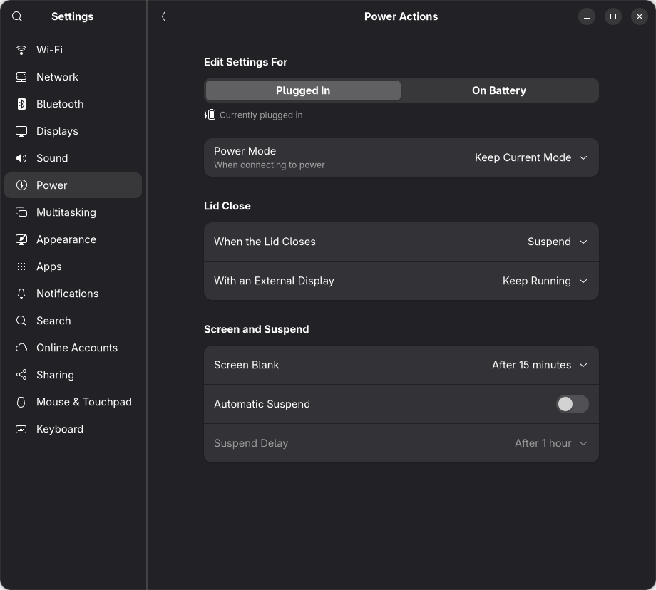
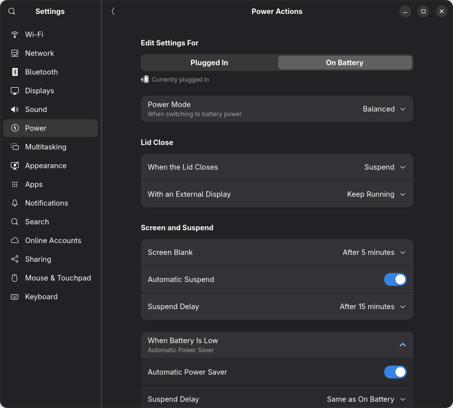

# Discussion Draft: Per-Source Power Actions in GNOME Settings

*Local discussion brief prepared for GNOME Discourse (Settings / Design). Not yet posted; links and upstream references to be verified separately before posting.*

## Summary

Many laptop users alternate daily between a desk setup (plugged into AC and an external monitor) and mobile battery use. Today in GNOME Settings, related behaviors are split across different models: automatic suspend already has separate AC and battery settings, screen blanking is a single global timeout, automatic power-mode changes exist only for low battery, and lid-close behavior is not configurable in Settings.

This draft proposes a **Power Actions** subpage under **Settings → Power → Power Saving** to configure **Plugged In** and **On Battery** behavior in one consistent layout, with **When Battery Is Low** nested inside **On Battery**. The goal of this discussion is to gather feedback from GNOME Design and Settings contributors on the information architecture and interaction model, and to identify a small, low-risk first upstream step.

---

## Concrete Scenario: Desk Dock to Battery

Consider a typical laptop workflow:

1. **At a desk (Plugged In, connected to an external monitor):** The user closes the laptop lid to keep working on the external display, wants a longer screen blank timeout while reading or monitoring tasks (for example, 15 minutes), turns off automatic suspend while plugged in, and either keeps their current power mode or switches to a preferred plugged-in mode.
2. **Away from the desk (On Battery):** The user unplugs to move to a meeting or travel. Now closing the lid should suspend the laptop, the screen should blank sooner (for example, 5 minutes), automatic suspend should trigger after 15 minutes, and the laptop can optionally switch to Balanced or Power Saver.
3. **When the battery runs low:** The user wants to see and adjust what changes on top of normal battery behavior—such as **Automatic Power Saver**—without altering their ordinary **On Battery** defaults.

Users should be able to configure both **Plugged In** and **On Battery** while sitting at their desk, without unplugging to reach battery settings and without browsing or switching the editing tab changing the live power state.

---

## Current State vs. Proposed Design

### Current GNOME Settings (`Power` Panel)

In GNOME Settings today, the **Power** panel is split into two views:

- **General**: Battery charge and health/charging controls, **Power Mode** (the active mode right now), **Power Button Behavior**, and **Show Battery Percentage**.
- **Power Saving**: **Automatic Screen Brightness**, **Dim Screen**, **Screen Blank** (global), **Automatic Power Saver** (for low battery), and **Automatic Suspend** (separate On Battery and Plugged In settings).

Where the current layout falls short for the laptop/dock case:

- **Per-source suspend vs. global screen blanking:** Automatic Suspend already uses separate AC and battery keys (`sleep-inactive-ac-*` and `sleep-inactive-battery-*` in `org.gnome.settings-daemon.plugins.power`), whereas Screen Blank uses a single global timeout (`org.gnome.desktop.session` `idle-delay`).
- **Live mode vs. transition defaults:** **Power Mode** in General and Quick Settings only changes the current mode. Outside of low battery, there is no opt-in way to choose a mode when plugging in or unplugging.
- **No UI for lid-close intent:** `gsd-power` currently inhibits `systemd-logind` lid suspend when an external monitor is connected and leaves lid-close suspend to `logind` otherwise, with no way in Settings to express whether closing the lid while docked should keep running or suspend.

### Proposed Design: `Settings → Power → Power Saving → Power Actions`

#### What stays put

- **General** keeps global hardware and live state controls: battery status/health/charging limits, **Current Power Mode**, **Power Button Behavior**, and **Show Battery Percentage**.
- **Power Saving** keeps global display-saving controls (**Automatic Screen Brightness** and **Dim Screen**).
- Each native setting should have **one editing destination** rather than being duplicated in both **Power Saving** and **Power Actions** (see the phased rollout section below for handling global **Screen Blank** in an initial step).

#### Entry point in Power Saving

Add a single navigation row in **Power Saving**:

- **Title:** `Power Actions`
- **Subtitle:** `Choose what happens when the lid closes or the laptop is idle`

The copy is intentionally neutral and task-focused rather than repeating power-source mechanics in the subtitle.

#### Figure 1: Power Saving entry point (desktop)

*Description:* Desktop layout of GNOME Settings with **Power** selected in the sidebar and **Power Saving** active in the header switcher. The top boxed list keeps **Automatic Screen Brightness** and **Dim Screen**. Below it is a single navigation row titled **Power Actions**, subtitled **"Choose what happens when the lid closes or the laptop is idle"**, with a disclosure chevron.

#### Figure 2: Power Saving entry point (narrow / 360px)

*Description:* Compact 360px layout of **Power Saving**. The sidebar collapses, the **General** / **Power Saving** switcher moves to the bottom bar, and the **Power Actions** row wraps cleanly under **Automatic Screen Brightness** and **Dim Screen**.

---

#### The `Power Actions` subpage

Activating **Power Actions** pushes a navigation page structured around two peer sources—**Plugged In** first, **On Battery** second:

- **Independent editing selector and live status:**
  - `Edit Settings For` uses a segmented toggle (`Plugged In` | `On Battery`) to answer *"Which settings am I editing?"*.
  - On opening, the selector initializes to the laptop's actual active power source when reliably known (with a deterministic fallback when unknown).
  - Once open, the selected editing tab **never changes automatically** during plug/unplug events, hardware probe updates, or low-battery transitions—preventing focus or context from jumping mid-edit.
  - A separate, non-interactive status caption underneath (e.g., `Currently plugged in`, omitted if unknown) answers *"What is the laptop using right now?"*. Browsing either tab never writes settings or activates a power profile.
- **Symmetrical primary rows:** Both **Plugged In** and **On Battery** present the same groups in the same order, with one primary control per row:
  1. **Power Mode** — transition rule (`When connecting to power` / `When switching to battery power`), proposed fresh default **Keep Current Mode** for both sources.
  2. **Lid Close** — **When the Lid Closes** and **With an External Display**.
  3. **Screen and Suspend** — **Screen Blank**, **Automatic Suspend**, and **Suspend Delay** (with **Suspend Delay** insensitive when **Automatic Suspend** is turned off).
- **Thoughtful hardware and capability adaptation:** Hide **Lid Close** on devices without a lid; hide **With an External Display** when its outcomes would not differ from the main lid action; hide or adapt **Power Mode** when no power-profiles backend is available; omit the **Plugged In** / **On Battery** selector on AC-only desktops. If a user already configured a non-preset timeout or an unusual action via `dconf`, display the real value accurately and preserve it when editing neighboring rows.
- **Nested low-battery exception with honest inheritance:** Under **On Battery** only, a **When Battery Is Low** expander row summarizes only the effective differences from ordinary battery behavior (for example, `Automatic Power Saver`, or `Automatic Power Saver · suspend after 5 minutes`). Inheritance wording such as `Same as On Battery` is used only where a setting genuinely inherits from **On Battery** rather than inferring inheritance from two equal values. Editing **When Battery Is Low** never modifies ordinary **On Battery** settings.

#### Figure 3: Plugged In view (desktop)

*Description:* Desktop layout inside **Power Actions** with **Plugged In** selected in `Edit Settings For` and `Currently plugged in` underneath. **Power Mode** (`When connecting to power`) is set to **Keep Current Mode**. Under **Lid Close**, **When the Lid Closes** is **Suspend** and **With an External Display** is **Keep Running**. Under **Screen and Suspend**, **Screen Blank** is **After 15 minutes**, **Automatic Suspend** is off, and **Suspend Delay** (**After 1 hour**) is insensitive.

#### Figure 4: On Battery view with nested Low Battery (desktop)

*Description:* Desktop layout of **Power Actions** with **On Battery** selected while the status caption still reads `Currently plugged in`, showing offline editing of the inactive source. **Power Mode** (`When switching to battery power`) shows **Balanced** as an illustrative configured value (fresh installs would default to **Keep Current Mode**). **Lid Close** preserves the same two rows. **Screen and Suspend** shows **Screen Blank** (**After 5 minutes**), **Automatic Suspend** on, and **Suspend Delay** (**After 15 minutes**). At the bottom, the expanded **When Battery Is Low** row summarizes `Automatic Power Saver` in its subtitle and reveals the **Automatic Power Saver** switch (on) and low-battery **Suspend Delay** (`Same as On Battery`).

#### Figure 5: On Battery view (narrow / 360px)

*Description:* Compact 360px layout of **Power Actions**. The sidebar collapses behind the back button, `Edit Settings For` (**Plugged In** | **On Battery**) stays full-width at the top with `Currently plugged in` below it, and every single-control row stacks cleanly without narrow side-by-side inputs.

---

## Key Behavioral Interactions to Align

### 1. General Current Mode vs. Source Transition Rules

- **General** and **Quick Settings** control the **current** active Power Mode right now.
- **Power Actions** defines **opt-in transition rules** applied when switching between AC and battery, with **Keep Current Mode** as the fresh default for both sources so existing GNOME behavior does not change unless opted in.
- **Manual selections and profile holds:** Switching Power Mode manually in Quick Settings or General should be treated as a user override rather than immediately fought by automation. How long a manual Quick Settings choice should last (until the next physical source transition vs. remembered per source) and how transition rules interact with application profile holds and backend battery-aware policies (`power-profiles-daemon` / `tuned-ppd`) remain open questions to settle with daemon maintainers.

### 2. Native Automatic Power Saver

- GNOME's existing **Automatic Power Saver** on low battery (owned by `gsd-power` via a `power-profiles-daemon` hold driven by UPower's low-battery signal) should remain authoritative rather than being replaced by a competing low-battery mode mechanism or custom percentage thresholds.
- Nesting it inside **On Battery → When Battery Is Low** keeps it discoverable in context while maintaining a single source of truth for low-battery power saving.
- Precedence between manual Quick Settings overrides, source transition rules, and `gsd-power`'s low-battery hold (both entering and leaving low battery) should be specified in `gsd-power`.

### 3. Per-Source Suspend vs. Global Screen Blanking

- Because `sleep-inactive-ac-*` and `sleep-inactive-battery-*` are already per-source while `org.gnome.desktop.session` `idle-delay` is currently global, placing a global **Screen Blank** row inside a **Plugged In** / **On Battery** switcher would mislead users into thinking AC and battery delays are independent when editing one overwrites the other.
- Accordingly, **Screen Blank** should remain global on **Power Saving** unless and until per-source screen blanking is supported natively.

### 4. External-Display and Closed-Lid Unplug Ambiguities

- **Competing lid-close expectations with an external display:** One user closes the lid at a desk to work in clamshell mode on an external monitor (**Keep Running**, matching GNOME's current behavior); another closes the lid at the end of the day expecting the laptop to suspend even though a monitor is still attached. Showing **With an External Display** only when the primary lid action would sleep/suspend lets both expectations be configured cleanly without adding noise when lid close is already **Keep Running**.
- **Unplugging a closed laptop from a dock:** When a laptop is closed in clamshell mode on a single-cable USB-C dock and the user pulls the cable, AC power and the external display disconnect nearly simultaneously (and events can arrive in either order). Most users expect the laptop to suspend after a brief safety window rather than staying awake in a bag, whereas disconnecting *only* a monitor on AC—or disconnecting *only* a separate charger while an HDMI display remains connected—is more ambiguous.
- Because `gsd-power` already owns GNOME's external-monitor `handle-lid-switch` inhibitor and safety timer—and must coordinate with the lock screen, fast user switching, and `systemd-logind`—native lid-close and undock policy should live in `gsd-power` rather than in ad-hoc UI workarounds.

---

## Scope and Out-of-Scope Boundary

### In Scope for GNOME Settings

- **Power Actions** subpage under **Power → Power Saving** with **Plugged In** / **On Battery** selectors, independent live status, symmetrical groups, and nested **When Battery Is Low**.
- Plain, outcome-based labels following GNOME HIG patterns, adaptive down to 360px, with accessible names, keyboard navigation, and accurate display of inherited, locked, or non-preset values.

### Out of Scope for GNOME Settings (Extension-Only / Advanced)

This proposal grew alongside a GNOME Shell extension prototype that pairs this simple GNOME-facing view with a separate **Advanced** preferences page over one shared settings model. The **Advanced** page is strictly **extension-only** and is **not** proposed for GNOME Settings:

- No separate **Advanced** page or mode in GNOME Settings.
- No sleep-method tuning (`s2idle`, `suspend-then-hibernate`, `hybrid-sleep`).
- No custom low-battery percentage threshold (rely on UPower's single system threshold so alerts and policies stay aligned).
- No user-facing knob for closed-lid unplug grace timing.
- No transition notifications, media-pause-on-suspend toggles, or technical info popovers explaining `systemd-logind`, `UPower`, or `dconf`.

---

## Open Decisions for Discussion

1. **Hierarchy & discoverability (by source vs. by setting):** Grouping by power source (**Plugged In** / **On Battery**) optimizes for configuring a whole situation at once, whereas grouping by setting optimizes for comparing one timeout across AC and battery (for context, recent macOS revisions have explored both layouts, though GNOME's HIG and existing Power panel structure are the design target here). Which mental model fits GNOME Settings best?
2. **Entry point and single editing destination:** Is `Power → Power Saving → Power Actions` the right place, and should existing source-specific settings (**Automatic Suspend** and **Automatic Power Saver**) move inside it so each setting has one home?
3. **Manual Quick Settings override & profile holds:** Should a manual Quick Settings Power Mode choice last until the next power transition, or update the rule for the current source? And if the user edits **Power Mode** for the *currently active* source in **Power Actions**, should it apply immediately or only on the next transition?
4. **Low-battery scope:** Should **When Battery Is Low** contain only **Automatic Power Saver**, or also an optional shorter low-battery **Suspend Delay**?
5. **Per-source Screen Blank:** Is splitting `idle-delay` per power source worth pursuing natively, or should **Screen Blank** remain a single global control on **Power Saving**?
6. **Lid-close wording and closed-lid undock policy:** Should **With an External Display** offer concrete outcome labels (**Keep Running** / **Suspend**) or relative wording (**Keep Running** / **Use Lid Close Action**), and what exact behavior should `gsd-power` enforce on closed-lid dock removal, lock screen, and user switching?

---

## Proposed Small First Upstream Ask

To keep upstream review focused and low-risk rather than proposing changes across Settings, schemas, and `gsd-power` lid handling all at once:

1. **First (this discussion):** Gather GNOME Design and Settings feedback on the **Power Actions** entry point, the **Plugged In** / **On Battery** selector with independent live status, and the nested **When Battery Is Low** structure.
2. **Small first implementation slice:** Start with **opt-in per-source Power Mode transition rules** (defaulting to **Keep Current Mode** for both sources, coordinated in `gsd-power` with native **Automatic Power Saver**, Quick Settings overrides, and app holds) alongside GNOME's already-per-source **Automatic Suspend** controls—keeping global **Screen Blank** on **Power Saving** for now.
3. **Separate follow-up proposals:** Review **per-source Screen Blank** and **Lid Close / external-display / closed-lid dock removal** ownership independently with GNOME Design and `gsd-power` maintainers.
