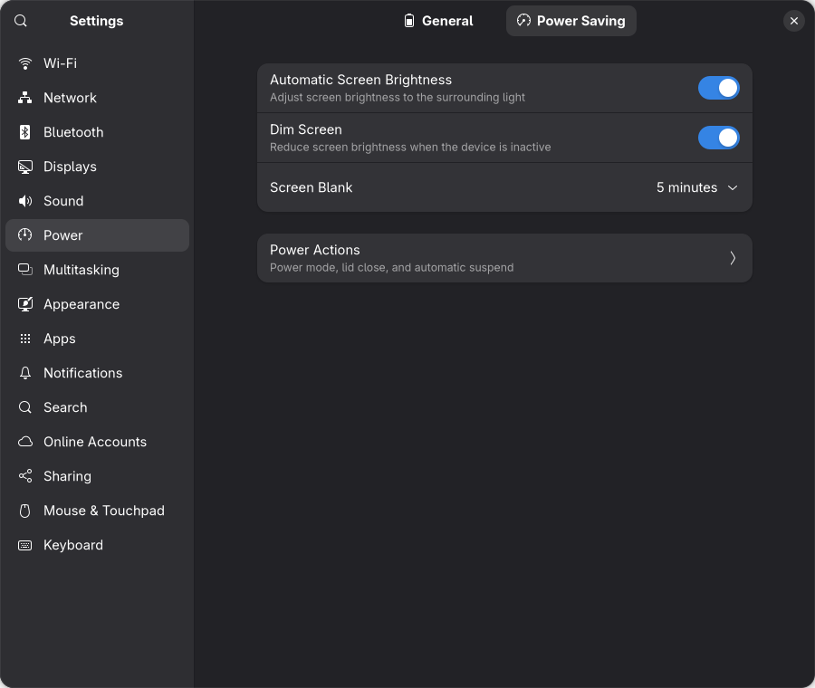
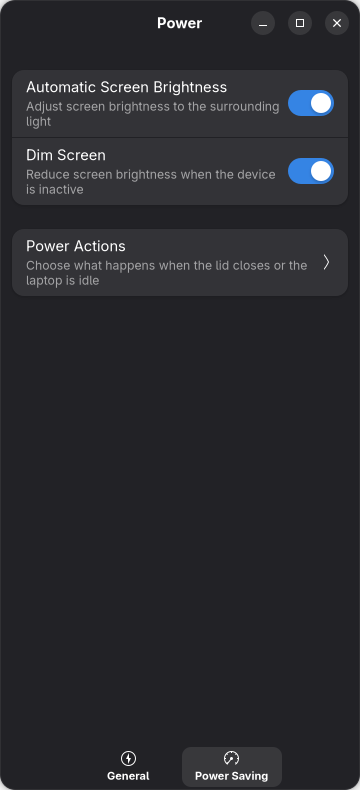
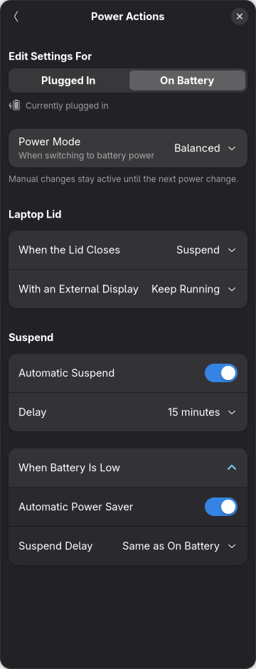

# Discussion Draft: Per-Source Power Actions in GNOME Settings

*Discussion brief prepared for GNOME Discourse (Settings / Design).*

## Summary

Most modern laptop workflows alternate daily between a desk setup (plugged into AC and an external monitor) and mobile battery use. Today in GNOME Settings, power behavior across those two situations is split across incompatible models: **Automatic Suspend** already has separate AC and battery settings, **Automatic Power Saver** exists only for low battery, **Power Mode** has no opt-in transition behavior on plug/unplug, **Screen Blank** is a single global timeout, and **lid-close behavior** is not configurable in Settings at all.

This proposal introduces a **Power Actions** subpage under **Settings → Power → Power Saving** that lets users configure **Plugged In** and **On Battery** behavior in one calm, symmetrical layout, with **When Battery Is Low** nested inside **On Battery**. Every rule is **opt-in and transition-based** (not a hard lock): fresh installs default to **Keep Current Mode**, and manual changes in Quick Settings or **Power → General** stay active until the next power change.

The goal of this discussion is to gather feedback from GNOME Design and Settings contributors on the information architecture and interaction model, and to agree on a small, low-risk first upstream slice.

---

## Why This Matters

This is not an obscure power-user tweak; it is a recurring daily friction point across GNOME laptops (reflected across long-running upstream discussions including `gnome-control-center#1600`, `gnome-settings-daemon#715`, `gnome-control-center#1223`, and `gnome-settings-daemon#712`):

- **Forgotten Power Mode wastes battery or hurts responsiveness:** If a user switches to *Performance* while plugged in for a build or video call and later unplugs to head to a meeting, GNOME stays in *Performance* on battery until hitting 20% Low Battery—draining battery and spinning fans unless the user remembers to flip Quick Settings every time they unplug. Conversely, users who drop to *Power Saver* on battery routinely stay throttled after plugging back in.
- **Answering the historical concern about "fighting the user":** Earlier discussion on `gnome-control-center#1600` raised an important concern: automatic AC/battery mode switching must not override a user who *intentionally* chooses *Power Saver* while plugged in at a quiet library, or *Performance* briefly on battery. Treating source rules as **opt-in transition defaults rather than hard locks** (defaulting to **Keep Current Mode** and respecting any manual change until the next physical power change) resolves that concern directly.
- **Conflicting lid-close expectations have real consequences:** Some users close the lid at a desk to work in clamshell mode on an external monitor; others close the lid at the end of the day expecting the laptop to suspend even though a monitor is still connected. Others want the lid to stay awake on AC (for audio playback or long tasks) while still suspending on battery so it never overheats in a bag. Today Settings provides no way to express that intent.
- **Users currently rely on fragile or root-only workarounds:** To get predictable AC/battery behavior today, users edit `/etc/systemd/logind.conf` with `sudo` (which is discouraged or awkward on atomic/immutable desktops like Silverblue/Bazzite and bypasses GNOME's external-monitor awareness) or stack multiple third-party GNOME Shell extensions (`auto-power-profile`, `ignore-lid`, etc.) that conflict with one another and break across GNOME releases.

---

## Concrete Scenario: Desk Dock to Battery

Consider a typical daily laptop workflow:

1. **At a desk (Plugged In, connected to an external monitor):** The user closes the laptop lid to keep working on the external display, turns off automatic suspend while plugged in, and either keeps their current power mode or switches automatically to a preferred plugged-in mode. *(Separating Screen Blank per source—for example, 15 minutes on AC vs. 5 minutes on battery—is also desirable, and is tracked as a separate follow-up below so global Screen Blank stays honest on Power Saving for now.)*
2. **Away from the desk (On Battery):** The user unplugs to move to a meeting or travel. Now closing the lid suspends the laptop, automatic suspend triggers after 15 minutes, and the laptop can optionally switch to *Balanced* or *Power Saver*.
3. **When the battery runs low:** The user wants to inspect and adjust what changes on top of normal battery behavior—such as **Automatic Power Saver**—without altering their ordinary **On Battery** defaults.

Users should be able to configure both **Plugged In** and **On Battery** while sitting at their desk, without unplugging to reach battery settings and without browsing or switching the editing tab changing the live power state.

---

## Current State vs. Proposed Design

### Current GNOME Settings (`Power` Panel)

In GNOME Settings today, the **Power** panel is split into two views:

- **General**: Battery charge and health/charging controls, **Power Mode** (the active mode right now), **Power Button Behavior**, and **Show Battery Percentage**.
- **Power Saving**: **Automatic Screen Brightness**, **Dim Screen**, **Screen Blank** (global), **Automatic Power Saver** (for low battery), and **Automatic Suspend** (separate On Battery and Plugged In settings).

Where the current layout falls short:

- **Live mode vs. transition defaults:** **Power Mode** in **General** and Quick Settings only changes the current mode. Outside of low battery, there is no opt-in way to choose a mode when plugging in or unplugging.
- **No UI for lid-close intent:** `gsd-power` currently inhibits `systemd-logind` lid suspend when an external monitor is connected and leaves lid-close suspend to `logind` otherwise, with no way in Settings to express whether closing the lid while docked should keep running or suspend.
- **Fragmented per-source settings:** **Automatic Suspend** already uses separate AC and battery keys (`sleep-inactive-ac-*` and `sleep-inactive-battery-*` in `org.gnome.settings-daemon.plugins.power`), and **Automatic Power Saver** is a low-battery exception, yet they are presented separately with no shared per-source mental model.

### Proposed Design: `Settings → Power → Power Saving → Power Actions`

#### What stays put

- **General** keeps global hardware and live state controls: battery status/health/charging limits, **Power Mode** (current active mode), **Power Button Behavior**, and **Show Battery Percentage**.
- **Power Saving** keeps global display-saving controls (**Automatic Screen Brightness**, **Dim Screen**, and global **Screen Blank** until per-source screen blanking exists natively).
- Each native setting has **one editing destination** rather than being duplicated in both **Power Saving** and **Power Actions**.

#### Entry point in Power Saving

Add a single navigation row in **Power Saving**:

- **Title:** `Power Actions`
- **Subtitle:** `Power mode, lid close, and automatic suspend`

The copy is concise, neutral across laptops and desktops, and names the exact behaviors controlled inside.

#### Figure 1: Power Saving entry point (desktop)

*Description:* Desktop layout of GNOME Settings with **Power** selected in the sidebar and **Power Saving** active in the header switcher. The top boxed list keeps global display controls (**Automatic Screen Brightness**, **Dim Screen**, and **Screen Blank** set to **5 minutes**). Below it is a single navigation row titled **Power Actions**, subtitled **"Power mode, lid close, and automatic suspend"**, with a disclosure chevron.

#### Figure 2: Power Saving entry point (narrow / 360px)

*Description:* Compact 360px layout of **Power Saving**. The sidebar collapses behind the top-left back button, the **General** / **Power Saving** switcher moves to the bottom bar, and **Power Actions** wraps cleanly below **Automatic Screen Brightness**, **Dim Screen**, and **Screen Blank**.

---

#### The `Power Actions` subpage

Activating **Power Actions** pushes a navigation page structured around two peer sources—**Plugged In** first, **On Battery** second:

- **Independent editing selector and live status:**
  - `Edit Settings For` uses a segmented toggle (`Plugged In` | `On Battery`) to answer *"Which settings am I editing?"*.
  - On opening, the selector initializes to the laptop's actual active power source when reliably known (with a deterministic fallback when unknown).
  - Once open, the selected editing tab **never changes automatically** during plug/unplug events, hardware probe updates, or low-battery transitions—preventing focus or context from jumping mid-edit.
  - A separate, non-interactive dimmed status caption underneath (e.g., `Currently plugged in`, omitted if unknown) answers *"What is the laptop using right now?"*. Browsing either tab never writes settings or activates a power profile.
- **Symmetrical primary rows:** Both **Plugged In** and **On Battery** present the same groups in the same order, with one primary control per row:
  1. **Power Mode** — transition rule (`When connecting to power` / `When switching to battery power`), proposed fresh default **Keep Current Mode** for both sources, accompanied by a concise caption (*"Manual changes stay active until the next power change."*).
  2. **Laptop Lid** — **When the Lid Closes** and **With an External Display**.
  3. **Suspend** — **Automatic Suspend** and **Delay** (with **Delay** insensitive when **Automatic Suspend** is turned off, using GNOME's standard duration labels such as `15 minutes` and `1 hour` without a redundant `"After"` prefix).
- **Thoughtful hardware and capability adaptation:** Hide **Laptop Lid** on devices without a lid; hide **With an External Display** when its outcomes would not differ from the main lid action; hide or adapt **Power Mode** when no power-profiles backend is available; omit the **Plugged In** / **On Battery** selector on AC-only desktops. If a user already configured a non-preset timeout or an unusual action via `dconf`, display the real value accurately and preserve it when editing neighboring rows.
- **Nested low-battery exception with honest inheritance:** Under **On Battery** only, a **When Battery Is Low** expander row summarizes only the effective differences from ordinary battery behavior when collapsed (for example, `Automatic Power Saver`, or `Automatic Power Saver · suspend after 5 minutes`). Inheritance wording such as `Same as On Battery` is used only where a setting genuinely inherits from **On Battery** rather than inferring inheritance from two equal values. Editing **When Battery Is Low** never modifies ordinary **On Battery** settings. (When ordinary **Automatic Suspend** on battery is turned off, the low-battery delay row should either clarify `Off (Same as On Battery)` or allow opting into a low-battery suspend delay explicitly.)

#### Figure 3: Plugged In view (desktop)

*Description:* Desktop layout inside **Power Actions** with **Plugged In** selected in `Edit Settings For` and `Currently plugged in` underneath. **Power Mode** (`When connecting to power`) is set to **Keep Current Mode**, followed by the manual-change caption. Under **Laptop Lid**, **When the Lid Closes** is **Suspend** and **With an External Display** is **Keep Running**. Under **Suspend**, **Automatic Suspend** is off and **Delay** (**1 hour**) is insensitive.

#### Figure 4: On Battery view with nested Low Battery (desktop)

*Description:* Desktop layout of **Power Actions** with **On Battery** selected while the status caption still reads `Currently plugged in`, showing offline editing of the inactive source. **Power Mode** (`When switching to battery power`) shows **Balanced** as an illustrative configured value (fresh installs would default to **Keep Current Mode**). **Laptop Lid** preserves the same two rows. **Suspend** shows **Automatic Suspend** on and **Delay** (**15 minutes**). At the bottom, the expanded **When Battery Is Low** row reveals the **Automatic Power Saver** switch (on) and low-battery **Suspend Delay** (`Same as On Battery`).

#### Figure 5: On Battery view (narrow / 360px)

*Description:* Compact 360px layout of **Power Actions**. The sidebar collapses behind the back button, `Edit Settings For` (**Plugged In** | **On Battery**) stays full-width at the top with `Currently plugged in` below it, and every single-control row—including the expanded **When Battery Is Low** section—stacks cleanly without narrow side-by-side inputs or clipping.

---

## Design Rationale: Why This Structure in GNOME Settings?

Each structural choice deliberately avoids common pitfalls in power-management UIs:

1. **Why a `Power Actions` subpage under `Power Saving` (instead of inline on `Power Saving` or a 3rd top-level tab)?**
   - Placing a **Plugged In** / **On Battery** switcher directly on **Power Saving** mixes *global* display controls (**Automatic Screen Brightness**, **Dim Screen**, **Screen Blank**) with *per-source* rules, leading users to assume display toggles vary by power source.
   - Adding a 3rd top-level tab next to **General** and **Power Saving** crowds the header view switcher (especially on narrow screens) and splits power-saving automation across two peer views.
   - Pushing a dedicated **Power Actions** subpage keeps **Power Saving** calm and uncluttered, scopes the entire page cleanly to the active power-source selector, and matches how Settings already drills down for structured configuration (such as the existing Automatic Suspend dialog).
2. **Why one `Plugged In` | `On Battery` switcher with a separate dimmed live status (instead of repeating AC and Battery rows vertically)?**
   - Listing every control twice (once for AC, once for Battery) doubles page length into a dense wall of controls.
   - A symmetrical peer switcher lets users think situationally (*"at my desk"* vs. *"on battery"*) with every setting in the same visual position, while the separate non-interactive `Currently plugged in` caption prevents confusing *"which source am I editing?"* with *"what power source is active right now?"*.
3. **Why nest `When Battery Is Low` inside `On Battery` (instead of a 3rd `Low Battery` peer tab)?**
   - Low battery is an **exception on top of On Battery**, not an independent third peer state (it cannot occur while plugged in, and most users override at most one or two behaviors).
   - Nesting it as an expander inside **On Battery** avoids repeating the entire settings list a third time, makes inheritance directly inspectable in context, and gives GNOME's existing **Automatic Power Saver** toggle a clear home.
4. **Why keep `General → Power Mode` separate from `Power Actions → Power Mode`?**
   - **General** (and Quick Settings) answers *"What Power Mode is active right now?"* (live state).
   - **Power Actions** answers *"What Power Mode should apply automatically when power changes?"* (opt-in transition rule). Keeping them separate guarantees that browsing or editing **On Battery** rules never spins up fans or alters the active mode.

---

## Key Behavioral Interactions to Align

### 1. General Current Mode vs. Source Transition Rules

- **General** and **Quick Settings** control the **current** active Power Mode right now.
- **Power Actions** defines **opt-in transition rules** applied when switching between AC and battery, with **Keep Current Mode** as the fresh default for both sources so existing GNOME behavior does not change unless opted in.
- **Manual selections and profile holds:** Switching Power Mode manually in Quick Settings or **General** is respected until the next power change rather than fought by automation. Exact precedence between manual choices, source transition rules, application profile holds, and backend battery-aware policies (`power-profiles-daemon` / `tuned-ppd`) should be settled with daemon maintainers.

### 2. Native Automatic Power Saver

- GNOME's existing **Automatic Power Saver** on low battery (owned by `gsd-power` via a `power-profiles-daemon` hold driven by UPower's low-battery signal) should remain authoritative rather than being replaced by a competing low-battery mode mechanism or custom percentage thresholds.
- Nesting it inside **On Battery → When Battery Is Low** keeps it discoverable in context while maintaining a single source of truth for low-battery power saving.
- Precedence between manual Quick Settings overrides, source transition rules, and `gsd-power`'s low-battery hold (both entering and leaving low battery) should be specified in `gsd-power`.

### 3. Per-Source Suspend vs. Global Screen Blanking

- Because `sleep-inactive-ac-*` and `sleep-inactive-battery-*` are already per-source while `org.gnome.desktop.session` `idle-delay` is currently global, placing a global **Screen Blank** row inside a **Plugged In** / **On Battery** switcher would mislead users into thinking AC and battery delays are independent when editing one overwrites the other.
- Accordingly, **Screen Blank** stays global on **Power Saving** in the mockups and initial design, unless and until per-source screen blanking is supported natively.

### 4. External-Display and Closed-Lid Unplug Ambiguities

- **Competing lid-close expectations with an external display:** One user closes the lid at a desk to work in clamshell mode on an external monitor (**Keep Running**, matching GNOME's current behavior); another closes the lid at the end of the day expecting the laptop to suspend even though a monitor is still attached. Showing **With an External Display** only when the primary lid action would sleep/suspend lets both expectations be configured cleanly without adding noise when lid close is already **Keep Running**.
- **Unplugging a closed laptop from a dock:** When a laptop is closed in clamshell mode on a single-cable USB-C dock and the user pulls the cable, AC power and the external display disconnect nearly simultaneously (and events can arrive in either order). Most users expect the laptop to suspend after a brief safety window rather than staying awake in a bag, whereas disconnecting *only* a monitor on AC—or disconnecting *only* a separate charger while an HDMI display remains connected—is more ambiguous.
- Because `gsd-power` already owns GNOME's external-monitor `handle-lid-switch` inhibitor and safety timer—and must coordinate with the lock screen, fast user switching, and `systemd-logind`—native lid-close and undock policy should live in `gsd-power` rather than in ad-hoc UI workarounds.

---

## Scope and Out-of-Scope Boundary

### In Scope for GNOME Settings

- **Power Actions** subpage under **Power → Power Saving** with **Plugged In** / **On Battery** selectors, independent live status, symmetrical groups, and nested **When Battery Is Low**.
- Plain, outcome-based labels following GNOME HIG patterns, adaptive down to 360px, with accessible names, keyboard navigation, and accurate display of inherited, locked, or non-preset values.

### Out of Scope for GNOME Settings (Extension-Only / Detailed View)

This proposal grew alongside a GNOME Shell extension prototype that pairs this simple GNOME-facing view (**Simple View (GNOME)**) with a separate **Detailed View** page over one shared settings model. **Detailed View** is strictly **extension-only** and is **not** proposed for GNOME Settings:

- No separate **Detailed View** / **Advanced** page or mode in GNOME Settings.
- No sleep-method tuning (`s2idle`, `suspend-then-hibernate`, `hybrid-sleep`).
- No custom low-battery percentage threshold (rely on UPower's single system threshold so alerts and policies stay aligned).
- No user-facing knob for closed-lid unplug grace timing.
- No transition notifications, media-pause-on-suspend toggles, or technical info popovers explaining `systemd-logind`, `UPower`, or `dconf`.

---

## Open Decisions for Discussion

1. **Hierarchy & discoverability (by source vs. by setting):** Grouping by power source (**Plugged In** / **On Battery**) optimizes for configuring a whole situation at once, whereas grouping by setting optimizes for comparing one timeout across AC and battery. Which mental model fits GNOME Settings best?
2. **Entry point and single editing destination:** Is `Power → Power Saving → Power Actions` the right place, and should existing source-specific settings (**Automatic Suspend** and **Automatic Power Saver**) move inside it so each setting has one home?
3. **Manual Power Mode changes & profile holds:** Should a manual Power Mode choice last until the next power transition, or update the rule for the current source? And if the user edits **Power Mode** for the *currently active* source in **Power Actions**, should it apply immediately or only on the next transition?
4. **Low-battery scope:** Should **When Battery Is Low** contain only **Automatic Power Saver**, or also an optional shorter low-battery **Suspend Delay**?
5. **Per-source Screen Blank:** Is splitting `idle-delay` per power source worth pursuing natively, or should **Screen Blank** remain a single global control on **Power Saving**?
6. **Lid-close wording and closed-lid undock policy:** Should **With an External Display** offer concrete outcome labels (**Keep Running** / **Suspend**) or relative wording (**Keep Running** / **Use Lid Close Action**), and what exact behavior should `gsd-power` enforce on closed-lid dock removal, lock screen, and user switching?

---

## Proposed Small First Upstream Ask

To keep upstream review focused and low-risk rather than proposing changes across Settings, schemas, and `gsd-power` lid handling all at once:

1. **First (this discussion):** Gather GNOME Design and Settings feedback on the **Power Actions** entry point, the **Plugged In** / **On Battery** selector with independent live status, and the nested **When Battery Is Low** structure.
2. **Small first implementation slice:** Start with **opt-in per-source Power Mode transition rules** (defaulting to **Keep Current Mode** for both sources, coordinated in `gsd-power` with native **Automatic Power Saver**, manual overrides, and app holds) alongside GNOME's already-per-source **Automatic Suspend** controls—keeping global **Screen Blank** on **Power Saving** for now.
3. **Separate follow-up proposals:** Review **per-source Screen Blank** and **Laptop Lid / external-display / closed-lid dock removal** ownership independently with GNOME Design and `gsd-power` maintainers.

---

## Related Upstream Discussions

- Power Mode per power source: [gnome-control-center#1600](https://gitlab.gnome.org/GNOME/gnome-control-center/-/issues/1600) · [gnome-settings-daemon#715](https://gitlab.gnome.org/GNOME/gnome-settings-daemon/-/issues/715)
- Automatic Power Saver daemon policy: [gnome-settings-daemon!247](https://gitlab.gnome.org/GNOME/gnome-settings-daemon/-/merge_requests/247)
- Lid-close & external display behavior: [gnome-control-center#1223](https://gitlab.gnome.org/GNOME/gnome-control-center/-/issues/1223) · [gnome-settings-daemon#712](https://gitlab.gnome.org/GNOME/gnome-settings-daemon/-/issues/712) · [GNOME Discourse external-monitor thread](https://discourse.gnome.org/t/how-can-i-configure-my-laptop-to-suspend-when-i-close-the-lid-and-an-external-monitor-is-attached/38684)
